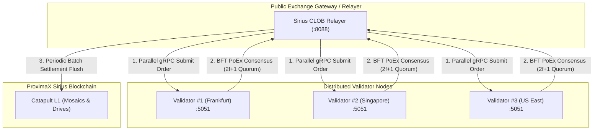

# Sirius SuperContract Validator Node (`sirius-validator-node`)

Turnkey, production-grade deployment package for running an independent **ProximaX Sirius SuperContract V2 Validator & Replicator Node**.

Each validator node executes the official WebAssembly matching engine (`sirius_clob.wasm`), maintains an isolated local drive ledger, and participates in Byzantine Fault Tolerant (BFT) Proof-of-Execution (`poex`) consensus across the cluster.

---

## 🏛️ Architecture Overview



---

## 🚀 Quick Start (1-Line Ubuntu VPS Install)

On any fresh Ubuntu (20.04 / 22.04 / 24.04) or Debian server:

```bash
curl -sSL https://raw.githubusercontent.com/igorgoc/sirius-validator-node/main/scripts/install_ubuntu.sh | bash
```

This automated script will:
1. Install Docker & Docker Compose if not already present.
2. Open port `5051/tcp` on UFW firewall.
3. Generate a secure random node authentication token.
4. Launch the validator daemon with auto-restart on boot.

---

## 🐳 Manual Docker Compose Setup

### 1. Clone the Repository
```bash
git clone https://github.com/igorgoc/sirius-validator-node.git /opt/sirius-validator-node
cd /opt/sirius-validator-node
```

### 2. Configure Environment (`config/node.env`)
```bash
cp config/node.env.example config/node.env
nano config/node.env
```

Key environment variables:
* `NODE_NAME`: Unique name for your validator (e.g. `validator-frankfurt`).
* `NODE_PORT`: gRPC port (default: `5051`).
* `SIRIUS_VM_AUTH_TOKEN`: Shared inter-cluster authentication token (optional but recommended in production).
* `SIRIUS_NETWORK`: `testnet2` (default) or `mainnet`.
* `SIRIUS_RPC_URL`: `https://api-2.testnet2.xpxsirius.io` (or `https://betelgeuse.xpxsirius.io` on Mainnet).
* `DRIVE_KEY_HEX`: SuperContract Drive key on Sirius chain (`bd1d100a98c34f62e170a8395b4498dc1e730286f5a12c489b37d01562f0cb23`).

### 3. Launch the Node
```bash
docker compose up -d --build
```

### 4. Check Status & Logs
```bash
# View live execution logs
docker compose logs -f

# Check healthcheck status
docker compose ps
```

---

## 🛡️ Standalone Linux Service (Without Docker)

If you prefer to run directly on the host using native systemd:

```bash
# 1. Install Node.js 20 LTS
curl -fsSL https://deb.nodesource.com/setup_20.x | bash -
apt-get install -y nodejs

# 2. Install dependencies
npm install --omit=dev

# 3. Install systemd service
cp systemd/sirius-validator.service /etc/systemd/system/
systemctl daemon-reload
systemctl enable sirius-validator
systemctl start sirius-validator
```

---

## 🔍 Healthcheck & Verification

Run the built-in healthcheck script anytime to verify node status:

```bash
node scripts/healthcheck.js
```

Expected output:
```text
✅ Healthcheck PASSED: Node [node1] alive (Uptime: 1420s)
```

---

## 🔒 Security Best Practices

1. **Firewall (UFW)**:
   Restrict inbound traffic on port `5051` so that only the Gateway server and peer validator IP addresses can connect:
   ```bash
   ufw allow from <GATEWAY_IP> to any port 5051 proto tcp
   ```
2. **WireGuard / Private Mesh**:
   For institutional production, deploy validator nodes inside a private WireGuard or Tailscale overlay mesh network.
3. **Contract Hash Whitelisting**:
   Set `SIRIUS_ALLOWED_WASM_SHA256` in `node.env` to the exact SHA-256 hash of the audited `sirius_clob.wasm` binary. The node will automatically reject execution of any unauthorized code.

---

## 📄 License
Apache-2.0. Copyright © 2026 ProximaX Sirius Team.
